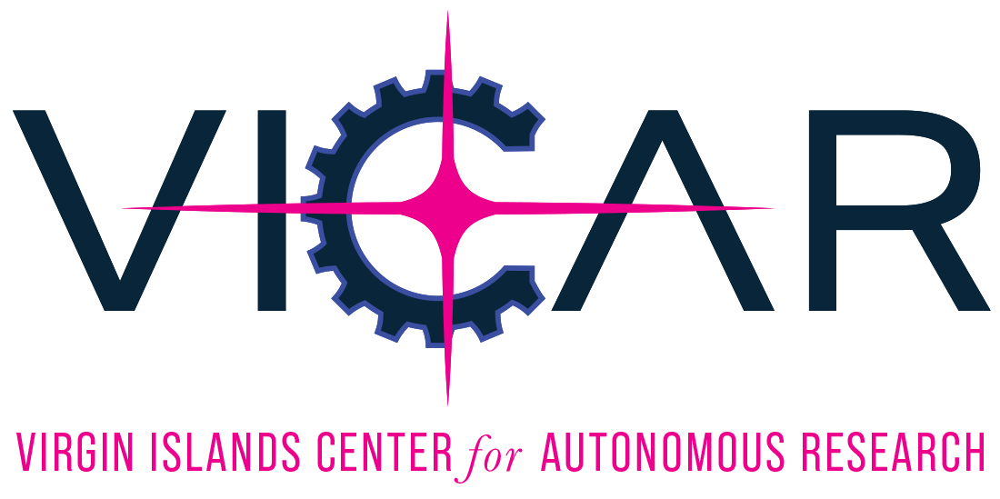
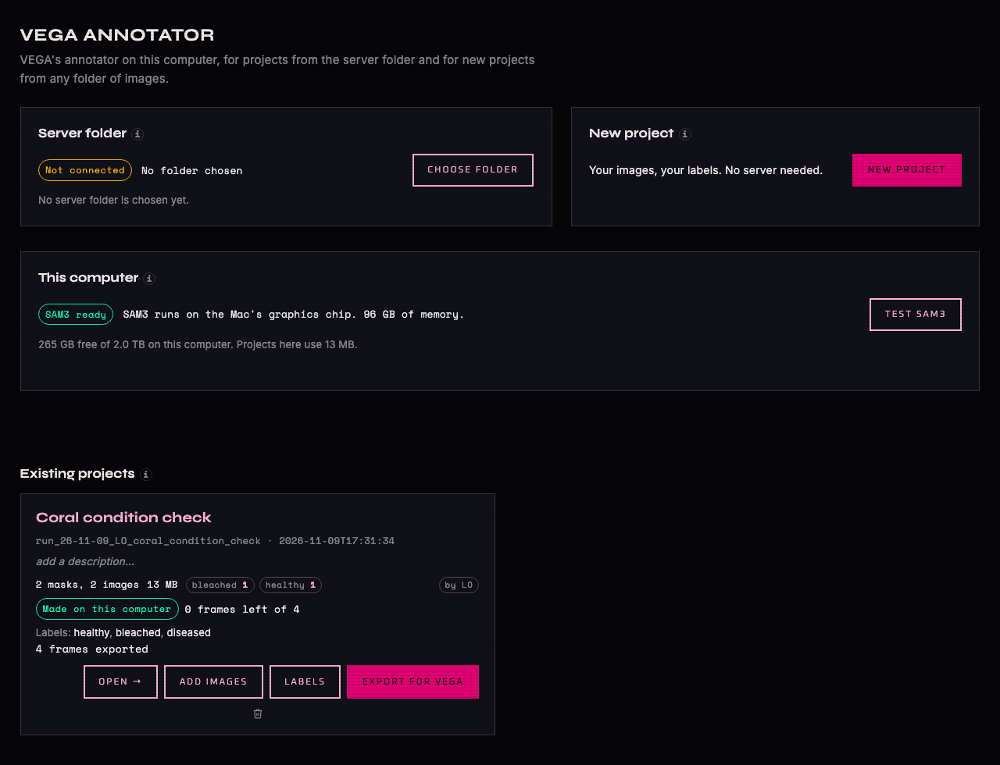

<p></p>

# VEGA Annotator by VICAR

VEGA Annotator runs VEGA's annotator on a Mac. It looks like VEGA because it is VEGA's code: the annotator's `app.py`, `index.html` and SAM3 engine run unchanged, and a thin layer starts them with laptop settings. Projects keep VEGA's folder layout and records.



There are two ways to work:

- **Start from any folder of images.** Click **NEW PROJECT**, pick a folder of photographs, and name your own labels, such as healthy, bleached or diseased. When you are done, **EXPORT FOR VEGA** writes one folder that VEGA can train on.
- **Label a VEGA project through a lab server folder.** VEGA makes the project on the lab's mainframe, and you bring it in, label it, and put it back.

## Install on a Mac

1. Download `VEGAAnnotator-<version>.pkg` from [Releases](https://github.com/laurenkolinger/vega-annotator/releases/latest).
2. Double-click it. macOS blocks an installer from an unidentified developer the first time: open **System Settings > Privacy & Security**, click **Open Anyway**, and run it again.
3. Read and accept Meta's SAM License, which covers SAM3, the model that draws the masks. The installer needs no administrator password.
4. VEGA Annotator opens and asks to download Python, PyTorch and SAM3 into its own folder, about 4.5 GB. Click **Download** and stay connected to the internet. It tells you each step.
5. On the home screen, click **TEST SAM3**.

It needs a Mac with an Apple chip, because PyTorch 2.11 does not run on Intel Macs. Tested on an Apple silicon Mac running macOS 27.

If the SAM3 download stops, the app still opens. Click **DOWNLOAD SAM3** on the home screen to try again; it picks up where it stopped. A lab member can instead click **INSTALL FROM SERVER FOLDER**, which copies SAM3 from the lab's server folder. If setup stops before Python is ready, open the app again to retry; the reason is at the end of `~/Library/Logs/VEGA Annotator install.log`.

Release 1.1 is for Macs only. Windows users can keep [release 1.0.0](https://github.com/laurenkolinger/vega-annotator/releases/tag/v1.0.0), which labels VEGA projects through a server folder.

## Start from any folder of images

1. Click **NEW PROJECT** and choose your folder. Photographs in subfolders count too.
2. Name the project, type your labels one per line, and give your initials and the purpose.
3. The app shows how many images it found, which files it skipped and why, and the space it needs. Click **CREATE**.

The app copies your images in with VEGA's own image import. Your folder is never changed. Each image is kept as its original plus a working JPEG, and an image larger than 1920 pixels on its long side is labeled at 1920 pixels, as in VEGA. JPEG and PNG come in as they are; HEIC, TIFF, BMP, WebP and GIF are converted first. A folder that **EXPORT FOR VEGA** wrote, or any other VEGA project, is left out, so its copies never come in a second time.

If the copy stops partway, for example when a drive comes out, the card says so and offers only **ADD IMAGES**, which brings in the rest from the same folder, and **REMOVE**.

**Labels.** A label is any word or short phrase you choose, up to 40 characters, made of letters, digits, spaces and `- _ . + ( )`. It needs at least one letter. Two labels may not differ only in capital letters. A few words are taken by VEGA or misread by the training file, so the app refuses them and says why: review, unk, yes, no, null, and the names of VEGA's export columns. Keys 1 to 9 pick the first nine labels while you label.

**Labeling.** Click **OPEN**. A click, or a box with **B**, makes a SAM3 mask; click again to add or remove parts. Pick its label, accept it, and export batches as you go, as in VEGA.

**Later.** **ADD IMAGES** brings in more photographs. **LABELS** adds labels; a label can be renamed or removed until your first export, because VEGA's training files number labels in order. Both work while the project is closed in the annotator.

## Hand your work to VEGA

Click **EXPORT FOR VEGA** on the project's card and choose where to write, such as a USB drive or a shared drive. The app writes one folder named for the project, with the date and time, so every hand-over is new and none overwrites another. It holds:

- your exported images as real files, their YOLO label files, and `data.yaml` with your labels in order;
- your masks (`segmentations/`), your working images, and VEGA's records of the export;
- `session.json`, which says who made it, when, and with which labels;
- `checksums.json`, so VEGA can tell the copy arrived whole;
- `README.txt`, which tells the person at the lab where it goes.

Original full-size images stay out unless you tick **Include originals**. The app refuses an export until at least one batch is exported in the annotator.

Send the folder to the lab in any way that works for you. At the lab, the folder goes into VEGA's Annotate Images sessions on the mainframe, where it trains in a training project of its own and never enters VEGA's survey records.

## Label a VEGA project through a server folder

1. VEGA makes the project on the mainframe, as it does now, and **Export project** on VEGA's project card copies it to the server folder.
2. On the home screen, click **CHOOSE FOLDER** and pick the `VEGA_Annotator` folder on your server.
3. Click **BRING IN**. The project copies to this Mac and is marked as in use here. You can then work with the server disconnected.
4. You label and export batches as in VEGA.
5. You click **PUT BACK**. Your work goes to the server folder in VEGA's own formats, with mainframe paths. If another computer took the project over or the server copy moved on, the app overwrites nothing: it saves your changed files under `conflicts/` beside the project and says so.
6. VEGA takes it back with **Import project**, which is specified and not yet built.

A project from a folder of images never shows **BRING IN** or **PUT BACK**.

## SAM3

SAM 3 is Meta's segmentation model, distributed under Meta's SAM License. The app downloads Meta's checkpoint from this repository's [sam3-weights-1](https://github.com/laurenkolinger/vega-annotator/releases/tag/sam3-weights-1) release, in two parts because GitHub limits a file to 2 GB. It checks each part against SHA-256 values pinned in its source, unpacks it, and checks every file again. It needs no Hugging Face account. The license travels with every copy, and research that uses SAM 3 must acknowledge it.

SAM3 runs on a Mac through the Hugging Face Transformers version VEGA already uses, which needs no CUDA. Eight real masks, reproduced on an M3 Max on 2 Nov 2026, overlapped the mainframe's masks by 99 percent or more.

| Computer | SAM3 runs on | Preparing a frame | A click |
|---|---|---|---|
| M3 Max Mac, 96 GB | Graphics chip | 1.4 s | 0.02 s |
| M3 Max Mac, processor only, 4 threads | Processor | 3.6 s | 0.02 s |
| Mac under 24 GB, such as a MacBook Air | Processor | not measured; run **TEST SAM3** | |

The app chooses by memory. The Mac graphics chip used about 9 GB and ran out under a simulated 8 GB limit, while the processor used 2.2 GB.

## Disk space

The home screen shows each project's size and this computer's free space. **NEW PROJECT**, **ADD IMAGES**, **BRING IN** and **EXPORT FOR VEGA** each say what they will write, and refuse when it would not fit.

| On this Mac | Size |
|---|---|
| The app, with Python and PyTorch | about 0.7 GB |
| SAM3 | 3.4 GB, once; the download needs 7.5 GB free while it runs |
| A project from a folder of images | the images, plus a working JPEG of each |
| A VEGA project when brought in | about 0.66 MB per frame, so 800 frames take about 0.53 GB |
| The same VEGA project fully labeled | about 1.4 MB per frame, so 800 frames take about 1.1 GB |

**Remove** takes a project off this Mac once the annotator is closed on it. Remove a project from a folder of images only after its work has gone to the lab with **EXPORT FOR VEGA**.

## What a VEGA project carries from TCRMP

A project brought in from the server folder carries everything the annotator reads, so the Mac needs nothing else from TCRMP.

| TCRMP data | On the Mac? | Why |
|---|---|---|
| Clip frames for the project | Yes, in the project | `routed_input/raw/` |
| Survey points for those frames | Yes, in the project | `reference_points` in `segmentations.json`, read from the point counts when VEGA routed the project |
| Label names | Yes, in the project | `master_codes_recoded.csv` |
| What other projects screened | Yes, in the project | `prior_screening.json`, refreshed when the project is exported |
| `all_points.csv` (85 MB) | No | VEGA uses it to choose frames, on the mainframe |
| `TCRMP_clip` (128 GB), `cpc_all` (67 GB), `TCRMP_CVR` (572 MB) | No | VEGA uses them to route frames, on the mainframe |

## What the app changes around VEGA's code

- It listens on 127.0.0.1 only and refuses other hosts and other web pages. VEGA's own launch listens on every network interface.
- It serves VEGA's fonts from local files, so the look holds with no internet.
- It adds a frames-left readout beside the frame counter.
- It leaves out the guided tutorial button, because the tutorial walks through mainframe windows.
- On a project from a folder of images, it hides VEGA's reef shortcuts (the Sponge, Macroalgae, Gorgonian and Turf buttons and their keys) and shows labels upright, where VEGA italicizes species names.

## Publish to the server folder

From a Mac with `ssh vicar-mainframe` set up, with `VEGA_PUBLISH_DEST` naming the folder on the mainframe:

```bash
packaging/mac/build_pkg.sh
```

```bash
tools/publish_to_server.sh
```

```bash
ssh vicar-mainframe python3 - --project run_YOURPROJECT --by LO --dest "$VEGA_PUBLISH_DEST/projects" < tools/publish_project.py
```

Raise `VERSION` in `vega_annotator/__init__.py` for each new release, because the Mac launcher restarts a running home screen only when the version changes.

`publish_project.py` reads the project and writes only to the server folder. It refuses a project with a running annotator. It also refuses to replace a server copy that a computer holds, or one holding laptop work VEGA has not taken back, unless `--replace-laptop-work` is passed.

## Update from VEGA

```bash
python3 tools/sync_from_vega.py
```

This copies the annotator files again and records the commit. `tests/test_vendor_parity.py` fails if a vendored file differs from that record, or if VEGA's page no longer has what the app relies on.

## Tests

```bash
.venv/bin/python -m pytest tests -q
```

```bash
VEGA_TEST_HF_HOME=/path/to/huggingface .venv/bin/python -m pytest tests -q
```

The second form also runs the real SAM3 weights on the CPU and the Mac graphics chip, and the whole click path in a real Chrome. `tests/test_pixels.py` takes screenshots of the app's pages and compares the annotator page with VEGA's own page whenever Chrome and node are on the computer. `.github/workflows/windows.yml` still tests on Windows, now only when started by hand.

## Uninstall

Stop the service and delete the app's folders. The second line also deletes your projects, so export them first.

```bash
launchctl bootout gui/$(id -u)/org.vicar.vega-annotator.home
```

```bash
rm -rf ~/Applications/"VEGA Annotator.app" ~/Library/Application\ Support/"VEGA Annotator" ~/Library/LaunchAgents/org.vicar.vega-annotator.home.plist
```

## Credits

SAM 3 is by Meta and is used under Meta's SAM License, included in the installer and in the [sam3-weights-1](https://github.com/laurenkolinger/vega-annotator/releases/tag/sam3-weights-1) release. VEGA is the VICAR lab's reef point segmentation pipeline.
